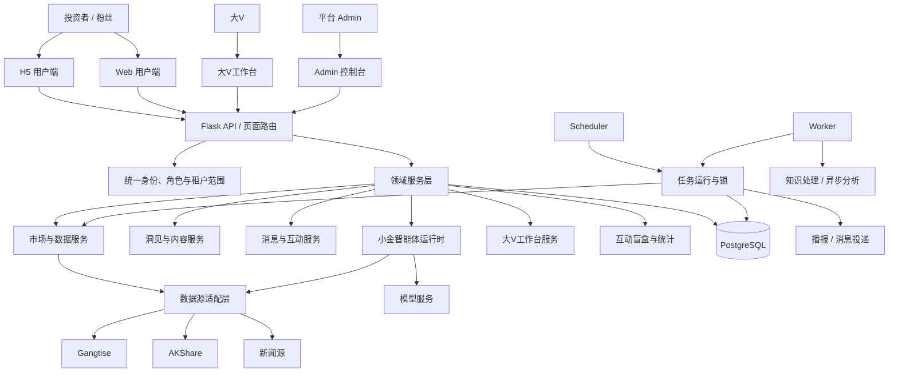

# 洞见智研技术架构先进性说明

版本：V1.0  
更新时间：2026-10-14  
适用场景：技术交流、合作方评估、产品路演、研发培训和架构评审

> 本文描述当前系统已经形成的技术架构能力，并区分正在治理的工程问题和未来演进方向。文中“先进性”指架构对当前业务的适配性、可观测性、可扩展性和演进空间，不等同于已经完成微服务化或达到大规模互联网平台的成熟度。

## 1. 总体结论

洞见智研当前采用的是一种适合投研产品快速迭代的**模块化单体架构**：以 Python/Flask 承载 Web 页面和 API，以 PostgreSQL 保存业务、租户、消息、内容、任务和审计数据，以独立 Worker 处理异步任务，以 Scheduler 负责定时调度，以统一的数据适配层连接 Gangtise、AKShare、新闻源和模型服务。

这套架构的先进性不在于技术名词数量，而在于已经把几个复杂领域放到了同一个可治理的业务框架中：

- 多租户的大V与粉丝关系；
- 市场、行业、宏观和个股数据；
- 洞见笔记、播报、消息和互动；
- 小金智能体的模型、工具和任务编排；
- 定时任务、异步处理、运行记录和手动执行；
- H5、Web、大V工作台和 Admin 的角色边界。

当前更准确的定位是：

> **面向投研场景的模块化智能应用平台，而不是简单的行情页面、内容 CMS 或通用聊天机器人。**

它已经具备继续向平台化发展的基础，但仍需要通过首屏拆分、统一鉴权、数据源契约、任务状态机、共享缓存和事件投递等工程治理，才能支撑更大用户量和更多租户。

## 2. 架构全景



### 2.1 运行角色

系统不是把所有工作都塞进 Web 请求，而是已经形成多个运行角色：

| 运行角色 | 主要职责 | 架构价值 |
|---|---|---|
| Web | 页面、API、认证和用户交互 | 保持请求链路清晰，承载前台访问 |
| Worker | 异步任务、知识处理、内容编排和耗时操作 | 避免长任务阻塞普通页面请求 |
| Scheduler | 定时同步、财经播报和周期任务 | 统一调度，减少重复执行 |
| PostgreSQL | 业务数据、快照、任务、消息和审计 | 提供持久化、一致性和可查询性 |
| Admin | 平台治理和功能控开 | 将平台级配置与日常用户操作分离 |

## 3. 模块化单体：当前阶段的合理选择

### 3.1 为什么不是简单的大单体

虽然系统仍然部署为一个主要 Python 应用，但代码已经按照领域拆分为 market、AI、commerce、knowledge、quiz、workbench、analytics 等模块，并通过 Web API、Domain Service、数据库和后台任务连接起来。

这带来几个实际收益：

- 市场数据逻辑不必散落在每个页面；
- 小金智能体可以统一编排模型和工具；
- 播报、指标同步和知识处理可以进入任务体系；
- H5、Web 和大V后台可以复用同一套后端业务能力；
- 复杂功能可以先在单体内验证，再根据真实瓶颈拆分。

### 3.2 为什么当前不建议直接拆成 Node.js + Python 微服务

Node.js 可以适合作为未来前端构建层、BFF 或实时推送服务，但它不能自动解决当前最主要的性能问题。当前更可能的瓶颈包括：

- 首页 HTML、脚本和初始化 JSON 过大；
- 页面初始化执行了过多无关查询；
- 数据库聚合和统计查询耗时；
- 外部数据源或模型服务延迟进入主链路；
- 多进程缓存无法共享；
- 异步副作用状态反馈不一致。

如果不先治理这些边界，增加 Node.js 只会增加一次网络跳转、部署单元、日志链路和故障排查复杂度。因此当前更先进的做法是先保持模块化单体，稳定 API 契约和运行指标，再按实际容量瓶颈选择性拆分。

## 4. 多租户架构与权限边界

洞见智研的核心不是单用户行情，而是“大V租户 + 粉丝用户”的研究服务关系。租户边界贯穿内容、消息、评论、盲盒、统计、知识和智能体上下文。

### 4.1 租户隔离

系统需要在三个层面同时保证隔离：

1. **身份层**：用户具有角色、所属租户和用户档案；
2. **服务层**：API 和 Domain Service 根据统一身份上下文过滤资源；
3. **数据层**：洞见、消息、评论、自选股互动和统计记录带有租户范围。

这比只在前端隐藏菜单更可靠。前端只是改善体验，真正的权限必须在后端校验。

### 4.2 角色分工

- Investor：使用所属租户内容和研究工具；
- DAv：管理自身租户、内容、指标、粉丝和运营数据；
- Admin：管理平台级租户、能力、模型、任务、审计和发布。

大V与粉丝的主要区别是权限，不是两套产品。H5 和 Web 用户端共用同一套业务 API，减少移动端和桌面端长期漂移的风险。

### 4.3 当前治理方向

当前仍应继续收敛重复的角色判断和 `tenant_slug` 处理，形成统一的 `AuthContext`、`TenantScope` 和 Policy 层。目标是让每个领域服务都能明确回答三个问题：当前用户是谁、当前租户是什么、当前动作是否被允许。

## 5. 数据架构：来源、快照和按需获取分层

### 5.1 数据源适配层

市场和投研数据来自不同类型的服务，供应商字段、错误码、计费方式和更新周期并不一致。因此业务页面不应该直接依赖某一家供应商的接口结构，而应通过统一适配器转换为内部模型。

内部结果至少应该区分：

- `source`：数据来源；
- `source_version`：供应商或接口版本；
- `as_of`：数据对应时间；
- `synced_at`：写入平台的时间；
- `freshness`：数据新鲜度；
- `status`：可用、过期、等待同步或失败；
- `trace_id`：本次采集和处理链路标识。

这样页面可以明确区分实时行情、最近有效交易日、历史快照和模型预测。

### 5.2 共享快照与按需数据

系统采用两种互补模式：

| 数据类型 | 推荐模式 | 原因 |
|---|---|---|
| 市场一览 | 后台采集后入库 | 多用户共享，减少重复 API 调用 |
| 热门行业 | 后台统一采集后入库 | 适合统一排序和租户选择展示 |
| 宏观指标 | 周期同步后入库 | 发布频率低，适合展示最近有效值 |
| 个股日K | 查看时按需获取并缓存 | 用户关注标的差异大，避免无效采集 |
| 个股分时 | 交易期间按需获取并缓存 | 实时性要求高，不适合全量轮询 |
| 新闻 | 统一新闻源处理 | 需要过滤、去重和保留来源链路 |

这种设计同时兼顾成本、实时性和系统承压能力。

### 5.3 数据质量不是 HTTP 状态码

数据接口返回 HTTP 200，只能说明网络请求完成，不代表业务数据有效。系统还要检查：

- 业务码是否成功；
- 返回记录是否存在；
- 正文或数值是否为空；
- 日期是否符合请求目标；
- 字段是否能映射到内部模型；
- 写库是否成功；
- 页面是否读取到最新有效快照。

这套“协议成功、业务成功、内容可用、写入成功、展示成功”的多层判定，是金融数据系统避免假成功的关键。

## 6. 小金智能体架构

小金智能体采用“模型理解 + 工具调用 + 租户上下文 + 结构化输出”的组合，而不是把所有问题直接交给一个通用聊天模型。

### 6.1 Agent Runtime 流程

```text
原始问题
  ↓
意图识别与任务拆解
  ↓
能力/Skill 选择
  ↓
参数校验与权限检查
  ↓
调用行情、新闻、研究或知识工具
  ↓
结果标准化与证据整理
  ↓
模型编排与用户易读输出
  ↓
保存会话、审计和 trace_id
```

### 6.2 咨询与任务双模式

- 咨询模式适合快速提问和多轮追问；
- 任务模式适合明确的个股观察、市场观察、主题跟踪、报告解读和多股分析。

通过模式化任务，系统可以把高频研究动作变成可复用能力，降低用户提问难度，也让每类任务可以单独配置模型、工具、超时、审计和输出格式。

### 6.3 结构化工具结果

未来应进一步要求工具统一返回结构化结果，例如：

```json
{
  "status": "success",
  "data": {},
  "source": "gangtise",
  "as_of": "2026-10-14T15:30:00+08:00",
  "trace_id": "...",
  "warnings": [],
  "error": null
}
```

编排层只负责组合这些结果，不再从 SSE、旧 JSON 或供应商文本中到处猜测成功条件。这样可以降低“HTTP 200 但没有可用分析文本”的重复问题。

### 6.4 智能体安全边界

- 模型不能绕过租户权限读取其他大V内容；
- 预测结果必须与历史事实分开标识；
- 外部工具失败时不能伪造答案；
- 研究辅助不能包装成确定收益或买卖承诺；
- 关键内容发布前保留大V人工审核；
- 模型、工具、提示词和 API 凭证由 Admin 统一配置和审计。

## 7. 异步任务与可观测性

播报、市场同步、行业同步、知识处理、图片处理、模型分析等任务不适合全部在同步 Web 请求中完成。当前系统已经具备 Scheduler、Worker、任务配置和运行记录，这是重要的架构基础。

### 7.1 任务统一模型

每个任务建议统一记录：

- 任务编码和业务名称；
- 触发方式：自动、手动或重试；
- 任务状态：queued、running、success、failed、stopped、cancelled；
- 计划时间、开始时间、结束时间；
- 租户范围；
- 幂等键；
- trace_id；
- 重试次数和下一次重试时间；
- 可读的错误原因和原始异常摘要。

### 7.2 Admin 与大V共享任务

Admin 和大V后台展示的是同一个平台任务，而不是各自复制一个任务。这样可以保证：

- 暂停状态同步；
- 手动执行不会生成两条调度链；
- 最近执行记录一致；
- 任务结果和失败原因一致；
- 播报不会因两个入口重复推送。

### 7.3 可靠投递

发布洞见或播报通常包含多个副作用：写入正文、生成消息、推送粉丝、更新统计、建立知识或审计记录。推荐采用：

```text
主业务事务提交
  ↓
Outbox 事件记录
  ↓
Worker 投递消息/通知/索引/统计
  ↓
记录每个副作用的状态
```

这样即使通知服务暂时失败，也不会把已成功的主业务误报为整体失败，也可以对单个副作用重试。

## 8. 前端架构先进性与改进方向

当前前端采用 Jinja 模板 + 原生 JavaScript + ECharts/Quill 等成熟组件。这种方式启动成本低，适合快速验证复杂业务；H5 和 Web 共用页面能力，也减少了两套产品重复开发。

### 8.1 当前优势

- 页面和后端数据契约距离短；
- 角色和租户状态可以在首屏注入；
- 无需引入完整 SPA 工程即可快速交付；
- ECharts 适合金融图表，Quill 适合富文本内容；
- H5 与 Web 可以共享业务渲染函数。

### 8.2 当前瓶颈

- H5、Workbench、Admin 模板体量较大；
- HTML、CSS、JavaScript 和页面状态混合；
- 非首屏能力可能参与初始下载和解析；
- 动态页面的错误、加载、空状态和成功状态需要统一；
- 组件复用依赖约定，缺少独立的前端模块边界。

### 8.3 演进方式

建议按功能拆分资源，而不是一次性重写：

```text
Shell
  ├── auth / tenant context
  ├── market feature
  ├── watchlist feature
  ├── insight feature
  ├── message feature
  ├── hermes feature
  ├── quiz feature
  └── workbench feature
```

首屏只加载 Shell、当前 Tab 和必要的状态；图表、智能体、工作台和知识模块进入后再加载。ECharts、Quill 等依赖统一使用本地静态资源和版本锁定，避免生产依赖外部 CDN。

## 9. 性能先进性与容量治理

架构先进性最终要落实到可度量的性能，而不是只看目录结构。

### 9.1 首屏优化

- 首屏只返回身份、租户、导航和首屏卡片；
- 非首屏 Dashboard、图表、智能体和工作台数据延迟加载；
- 拆分大模板和大脚本；
- 压缩静态资源，设置长期缓存和版本指纹；
- API 避免返回无关的全量配置和历史记录。

### 9.2 数据库优化

- 使用统一连接池并设置上限；
- 记录慢查询和查询耗时；
- 为租户、用户、时间和任务状态建立复合索引；
- 把重复统计改为预聚合或异步统计；
- 页面读取优先读取本地快照，不在请求中调用外部数据源。

### 9.3 外部服务治理

每个 Gangtise、AKShare、新闻源和 LLM 调用都应具备：

- 连接和读取超时；
- 限流；
- 失败重试上限；
- 熔断或短期降级；
- 成功/空内容/业务失败分类；
- 计费或调用次数记录；
- trace_id 和耗时记录。

### 9.4 建议容量指标

当前不能仅凭静态代码严肃宣称最大并发量，应建立实测基线：

| 指标 | 建议观察项 |
|---|---|
| 首屏 | TTFB、完整加载时间、HTML/JS/JSON 体积 |
| API | P50/P95/P99、5xx、超时率和响应体大小 |
| 数据库 | 活跃连接、池等待、慢查询、锁等待和缓存命中 |
| Worker | 队列长度、任务耗时、失败率和重试量 |
| 外部服务 | 请求耗时、业务成功率、空内容率和计费次数 |
| 主机 | CPU、RSS、FD、网络带宽和进程数 |

## 10. 可扩展性路线

### 阶段一：稳定模块化单体

- 统一身份和租户范围；
- 统一数据源 Provider Contract；
- 统一任务状态机和幂等键；
- 页面只读快照，远程采集只由任务或显式 API 触发；
- 拆分首屏资源；
- 修复异步发布和通知状态不一致。

### 阶段二：增强平台运行能力

- 引入 Redis 或等价共享缓存；
- 引入 Outbox 和可靠事件投递；
- 建立任务队列、死信和重试面板；
- 建立统一日志、指标、trace_id 和告警；
- 对 Agent、市场数据和消息投递分别做容量测试。

### 阶段三：按瓶颈选择性拆分

只有当监控证明单体边界成为瓶颈时，才拆出独立服务：

- Market Data Service：数据源、快照和新鲜度；
- Agent Runtime：模型、工具、SSE 和长任务；
- Notification Service：站内信、播报和推送；
- Content Processing Service：富文本、图片、URL 和知识处理。

拆分必须以稳定 API 契约、独立部署收益和明确容量目标为前提，而不是为了追求“微服务”形式。

## 11. 安全与合规架构

金融科技产品需要把安全设计放在业务逻辑前面。

- API Key、数据库密码和模型凭证只从受控配置或数据库读取，不写入前端；
- 日志脱敏，不记录完整 Token、密码和敏感请求体；
- Admin、DAv 和投资者权限分离；
- 租户数据查询默认带 scope；
- 文件、URL、图片和模型输入需要大小、类型和内容安全限制；
- 重要操作记录操作者、时间、来源 IP、目标对象和结果；
- 内容发布、权益变化、任务手动执行和权限修改可审计；
- 数据源、模型预测和大V观点清晰标识，避免误导用户。

## 12. 当前架构成熟度判断

| 领域 | 当前判断 | 说明 |
|---|---|---|
| 业务模块化 | 中上 | 已按领域拆分，但核心服务文件仍偏大 |
| 多租户能力 | 中上 | 产品边界清晰，统一 Policy 和数据库约束仍需强化 |
| 数据适配 | 中等 | 有多数据源能力，但供应商切换和回退语义需统一 |
| Agent 架构 | 中上 | 已具备任务、工具和模型编排，需统一结构化契约 |
| 异步任务 | 中上 | Scheduler/Worker/运行记录已存在，可靠投递仍需完善 |
| 前端工程化 | 中等 | 交付效率高，但模板和脚本偏重，需继续拆分 |
| 可观测性 | 中等 | 已有日志和运行记录，指标、追踪和告警需体系化 |
| 性能成熟度 | 中等偏低 | 需补充真实并发、慢查询和外部依赖压测 |
| 扩展准备度 | 中上 | 适合继续做模块化单体，尚不适合无计划地拆微服务 |

## 13. 最终评价

洞见智研当前最有价值的技术特点，是把投研数据、租户内容、智能体工具、粉丝互动和平台治理放入了一个可持续演进的系统中。它已经超越了“页面 + API”的原型形态，形成了任务、快照、权限、知识、消息和模型能力之间的组合架构。

当前架构最正确的演进方向是：

1. 先统一边界和数据契约；
2. 再治理首屏、连接池、缓存和异步投递；
3. 用真实指标验证容量瓶颈；
4. 最后按瓶颈选择性拆服务。

因此，对外可以将洞见智研描述为：

> **一个以模块化单体为当前承载形态、以异步任务和统一数据服务为基础、以租户隔离和 Agent 工具编排为核心、具备向平台化和服务化演进能力的智能投研架构。**

## 14. 参考代码与资料

- [src/domain/market_services.py](/Users/xuchenfei/PycharmProjects/gangtise_demo/src/domain/market_services.py)
- [src/domain/ai_services.py](/Users/xuchenfei/PycharmProjects/gangtise_demo/src/domain/ai_services.py)
- [src/domain/core_services.py](/Users/xuchenfei/PycharmProjects/gangtise_demo/src/domain/core_services.py)
- [src/process_scheduler.py](/Users/xuchenfei/PycharmProjects/gangtise_demo/src/process_scheduler.py)
- [src/process_worker.py](/Users/xuchenfei/PycharmProjects/gangtise_demo/src/process_worker.py)
- [docs/knowledge_base_software_architecture.md](/Users/xuchenfei/PycharmProjects/gangtise_demo/docs/knowledge_base_software_architecture.md)
- [docs/system_architecture_refactor_plan.md](/Users/xuchenfei/PycharmProjects/gangtise_demo/docs/system_architecture_refactor_plan.md)
- [reports/software_design_review_2026-10-14.html](/Users/xuchenfei/PycharmProjects/gangtise_demo/reports/software_design_review_2026-10-14.html)
